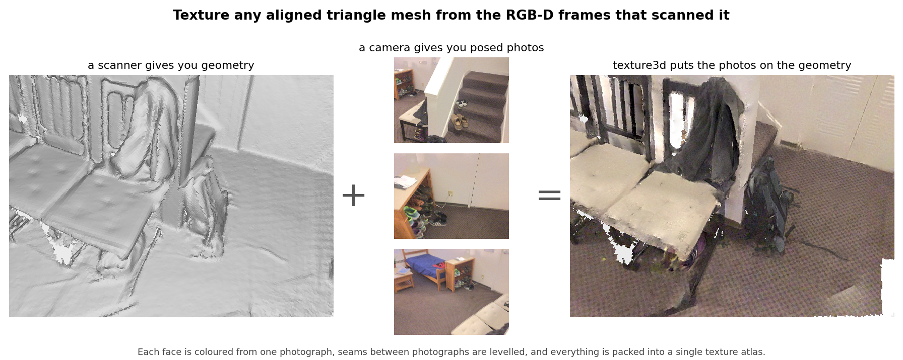
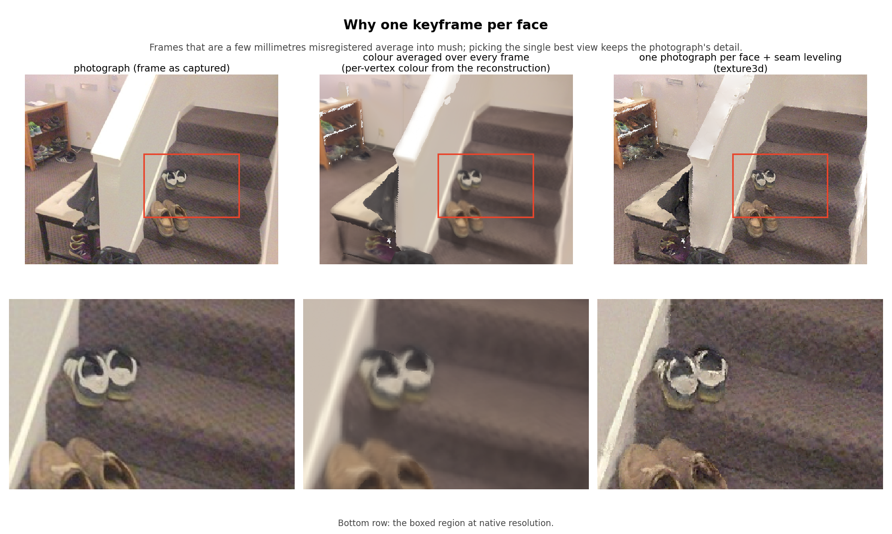
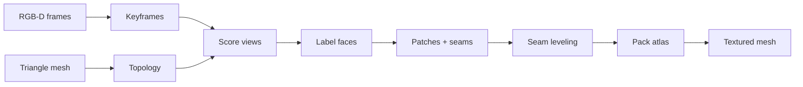
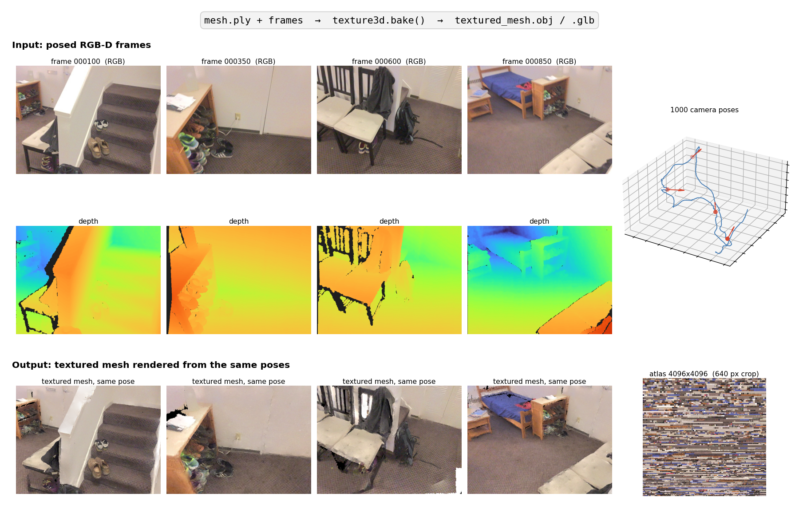

# texture3d

Texture an aligned triangle mesh from posed RGB-D frames — one photograph per face, seams levelled, one atlas out.

[](#installation)
[](#license)
[](https://github.com/saikiran321/texture3d)

Not on PyPI yet. Install from this repo. The texturing library is trimesh-based and does not depend on Open3D; reconstruction (optional, same repo) does.



*A scanner gives you geometry; a camera gives you posed photos. `texture3d` puts each photo onto the faces it sees best, levels the seams, and packs one atlas. `apt0_seq0`: 977k faces, 1000 frames, 58 keyframes, ~2 min on a laptop.*

## Quick start

```bash
python3 -m venv .venv
.venv/bin/pip install -e ".[dev]"
```

```python
import texture3d

frames = texture3d.load_dataset("path/to/dataset")  # directory with dataset.json
result = texture3d.bake("mesh.ply", frames)
result.export("textured_mesh.obj")  # or .glb
print(result.stats)
```

```bash
.venv/bin/texture3d path/to/dataset --mesh mesh.ply --out textured/run
```

You need a triangle mesh in the same world frame as the camera poses, plus RGB-D frames. See [Dataset layout](#dataset-layout). Without a `dataset.json` folder, build `RGBDFrame` objects yourself ([Usage](#usage)).

## Table of contents

- [Why](#why)
- [Features](#features)
- [Installation](#installation)
- [Usage](#usage)
- [CLI](#cli)
- [Configuration](#configuration)
- [How it works](#how-it-works)
- [RGB-D reconstruction](#rgb-d-reconstruction)
- [Dataset layout](#dataset-layout)
- [Testing](#testing)
- [Limitations](#limitations)
- [License](#license)

## Why

Averaging every view onto a texel blurs photograph detail as soon as poses or geometry are off by a few millimetres. **texture3d** assigns each face one keyframe (the view that sees it best), cuts connected same-view faces out as patches, then hides the seams with a global colour-offset solve and a local Poisson blend. The result is a single-material textured mesh (OBJ or GLB). Input UVs are ignored; output UVs follow the labelling, with vertices split along patch borders.



*Left: a captured frame. Middle: the TSDF reconstruction's per-vertex colour, i.e. every frame averaged — the carpet weave and the shoes smear. Right: `texture3d`, one photograph per face. Bottom row is the boxed region at native resolution.*

This repo also ships an Open3D TSDF reconstruction pipeline for turning a `dataset.json` sequence into `mesh.ply`. You can texture that mesh, or an untextured STL/OBJ from another engine, as long as it is aligned to the same poses.

**Status:** 0.2.0 — end-to-end usable, public API may still change.

## Features

- **One keyframe per face** — sharpness-weighted view scoring, outlier rejection on mean face colour, MRF labelling with Potts smoothness
- **Seam leveling** — global least-squares offsets in YCbCr, then a Poisson blend along a configurable border strip
- **Single atlas** — MaxRects packing (shelf packer above 4,000 patches), optional unsharp mask
- **Unseen-face fill** — sub-pixel faces inherit a neighbour's view instead of speckling the empty colour
- **Dataset-agnostic inputs** — `RGBDFrame` + `PinholeCamera`, or `load_dataset()` for the `dataset.json` layout
- **OBJ and GLB export** via trimesh; `result.stats` reports coverage and per-stage timings

## Installation

**Prerequisites:** Python 3.9 or newer. Texturing needs NumPy, SciPy, OpenCV, trimesh, and Pillow (pulled in by the package). Reconstruction additionally needs Open3D 0.18 and NumPy 1.x (`requirements.txt`).

### Texturing library + CLI

```bash
git clone https://github.com/saikiran321/texture3d.git
cd texture3d
python3 -m venv .venv
.venv/bin/pip install -e .
```

Dev extras (pytest, ruff):

```bash
.venv/bin/pip install -e ".[dev]"
```

### Reconstruction extras

```bash
.venv/bin/pip install -r requirements.txt
```

Open3D 0.18 is built against the NumPy 1.x ABI. Keep `numpy>=1.24,<2` in that environment; NumPy 2.x can segfault during TSDF integrate.

<!-- TODO: add a PyPI one-liner when the package is published -->

## Usage

### From a `dataset.json` directory

```python
import texture3d

frames = texture3d.load_dataset("assets/datasets/apt0_seq0")
result = texture3d.bake(
    "assets/reconstructions/apt0_seq0/mesh.ply",
    frames,
)
result.export("textured/apt0_seq0/textured_mesh.obj")
print(result.stats["textured_fraction"], result.stats["stage_seconds"])
```

`BakeResult` has `.mesh` (textured `trimesh.Trimesh`), `.texture` (uint8 RGB atlas), and `.stats`.

### From frames you already have in memory

```python
import numpy as np
import texture3d
from texture3d import BakeConfig, PinholeCamera, RGBDFrame

camera = PinholeCamera(width=640, height=480, fx=582.871, fy=582.871, cx=320.0, cy=240.0)
pose_c2w = np.eye(4)  # camera-to-world, OpenCV convention (+z forward, +y down)
rgb = ...             # HxWx3 uint8, RGB
depth_m = ...         # HxW float32 meters, 0 = invalid

frames = [
    RGBDFrame(pose_c2w=pose_c2w, camera=camera, rgb=rgb, depth=depth_m, depth_scale=1.0),
]
cfg = BakeConfig()
cfg.keyframes.rgbd_frame_gap = 1
result = texture3d.bake("mesh.ply", frames, cfg)
result.export("textured_mesh.glb")
```

Poses are 4×4 **camera-to-world**. Integer depth images (and integer files) are multiplied by `depth_scale` (default `1e-3` for millimetre PNGs). Float arrays are treated as metres already.

### Tuning

```python
from texture3d import BakeConfig

cfg = BakeConfig()
cfg.keyframes.rgbd_frame_gap = 5          # 1 keyframe per N frames
cfg.mapping.data_smoothness_ratio = 0.05  # lower → larger patches
cfg.mapping.sharpness_weight = 0.0        # disable unsharp mask
cfg.mapping.local_leveling_strip_width = 30
cfg.mapping.fill_unseen = True
```

## CLI

```
texture3d DATASET_DIR --mesh mesh.ply [--out DIR] [--format obj|glb]
```

| Flag | Default | Meaning |
| --- | --- | --- |
| `--mesh` | `reconstructions/<dataset-name>/mesh.ply` | Mesh to texture (`.ply` / `.obj` / `.stl`) |
| `--out` | `textured/<dataset-name>` | Output directory |
| `--format` | `obj` | `obj` or `glb` |
| `--gap` | `5` | One keyframe per N frames (`1` = all) |
| `--outlier` | `0.06` | Drop views below this colour likelihood (`0` = off) |
| `--data-ratio` | `0.1` | Data cost vs smoothness; lower = larger patches |
| `--no-global-leveling` | off | Skip the global colour-offset solve |
| `--no-local-leveling` | off | Skip the Poisson border blend |
| `--strip-width` | `20` | Local leveling strip width in pixels |
| `--sharpness` | `0.5` | Unsharp-mask weight (`0` = off) |
| `--max-texture` | `8192` | Largest atlas edge in pixels |
| `--no-fill-unseen` | off | Leave sub-pixel faces in the empty colour |

Writes `textured_mesh.<format>`, `config.json`, and `summary.json`. If the default mesh path does not exist, pass `--mesh` explicitly.

```bash
.venv/bin/texture3d assets/datasets/apt0_seq0 \
  --mesh assets/reconstructions/apt0_seq0/mesh.ply \
  --out textured/apt0_seq0
```

On a 977k-face mesh with 58 keyframes (640×480, 18-core Mac) this run was about **120 s** (scoring 8 s, labelling 9 s, global leveling 15 s, local leveling 82 s, atlas 1 s), **85%** of faces textured (the rest is the TSDF back shell no camera saw), 4096 atlas.

`run_texturing.py` is a thin shim around the same CLI.

## Configuration

`BakeConfig` / `KeyframeConfig` / `MappingConfig` (`texture3d.config`):

| Name | Type | Default | Description |
| --- | --- | --- | --- |
| `keyframes.rgbd_frame_gap` | int | `5` | Least-blurry frame in every window of this many frames |
| `keyframes.closest_pose_translation` | float | `0.05` | Skip a candidate within this many metres of the last keyframe |
| `keyframes.closest_pose_rotation_angle` | float | `0.09` | Same, for relative rotation (radians) |
| `mapping.outlier_threshold` | float | `0.06` | Gaussian colour likelihood; `0` disables |
| `mapping.data_smoothness_ratio` | float | `0.1` | Data cost scale vs Potts smoothness |
| `mapping.global_seam_leveling` | bool | `True` | Least-squares colour offsets per (vertex, patch) |
| `mapping.local_seam_leveling` | bool | `True` | Poisson blend along patch borders |
| `mapping.local_leveling_strip_width` | int | `20` | Blend strip width in pixels |
| `mapping.sharpness_weight` | float | `0.5` | Unsharp mask; `0` disables |
| `mapping.max_texture_size` | int | `8192` | Max atlas edge (power of two) |
| `mapping.empty_color` | RGB tuple | `(255, 255, 255)` | Texels no patch covers |
| `mapping.scoring_workers` | int | `4` | Views scored in parallel |
| `mapping.fill_unseen` | bool | `True` | Neighbour view for sub-pixel faces |
| `mapping.exact_packing_limit` | int | `4000` | MaxRects up to this many patches; shelf packer beyond. `0` = always MaxRects |

## How it works



1. **Keyframes** — least blurry frame in each `--gap` window (Crete metric); near-duplicate poses are skipped.
2. **Topology** — incidence, edge adjacency, face normals smoothed over neighbours within 25°.
3. **Scoring** — depth-tested face maps; quality is blurred Sobel magnitude times squared cosine to the normal. Colour outliers are dropped.
4. **Labelling** — MRF over the face graph (views + “none”), loopy belief propagation.
5. **Patches** — connected same-view faces, 2 px border in that view; seam vertices where patches meet.
6. **Leveling** — global Tikhonov-regularised offsets (λ = 0.1), then a 20 px Poisson strip.
7. **Atlas** — pack, copy levelled pixels, write per-corner UVs, optional sharpen.


*Stages 4–7 on one view of `apt0_seq0`. Column 4 is the atlas itself: patches are packed largest-first, so the top-left corner holds whole surfaces (stairs, picture wall, door) at full resolution; the long tail of small patches fills the rows below. 48 % of the 4096² atlas is used.*

Faces no camera sees stay the empty colour (typical TSDF back shell). `result.stats["stage_seconds"]` times each stage.

To check a bake visually, render the textured mesh back from dataset poses and compare with the photos:



```bash
# input/output check above
.venv/bin/python tools/make_readme_figure.py assets/datasets/apt0_seq0 textured/apt0_seq0 \
  --frames 100,350,600,850 --out docs/figures/pipeline.png
# purpose / why / how figures used in this README
.venv/bin/python tools/make_story_figures.py assets/datasets/apt0_seq0 \
  assets/reconstructions/apt0_seq0/mesh.ply textured/apt0_seq0 --out docs/figures
```

Package layout: `src/texture3d/` is the installable library (`bake`, `camera`, `io`, `mapping/`). `rgbd_recon/` is reconstruction only.

## RGB-D reconstruction

Optional. Fuses a `dataset.json` sequence with Open3D TSDF (OpenCV depth cleanup first).

```bash
.venv/bin/pip install -r requirements.txt
.venv/bin/python run_reconstruction.py assets/datasets/apt0_seq0
.venv/bin/python run_reconstruction.py assets/datasets/apt0_seq0 --stride 3 --voxel 0.02
```

Writes to `reconstructions/<name>/` by default: `mesh.ply`, `point_cloud.ply`, `trajectory_tum.txt`, `config.json`, `summary.json`.

`create_rgbd_dataset.py` cuts contiguous windows from a BundleFusion-style capture into that layout. Three `apt0` windows used while developing:

| Subset | Source frames |
| --- | --- |
| `apt0_seq0` | 0–999 |
| `apt0_seq1` | 3780–4779 |
| `apt0_seq2` | 7560–8559 |

Those sequences are not in the git tree (`assets/` is gitignored). Point `--output-root` / dataset paths at your own copy.

## Dataset layout

`texture3d.load_dataset(dir)` expects `dir/dataset.json`:

```json
{
  "image_size": {"width": 640, "height": 480},
  "intrinsics": {
    "color_matrix_3x3": [[fx, 0, cx], [0, fy, cy], [0, 0, 1]],
    "depth_matrix_3x3": null
  },
  "depth": {"scale_to_meters": 0.001},
  "frames": [
    {"frame_id": "000000", "rgb": "000000/rgb.jpg", "depth": "000000/depth.png", "pose": "000000/pose.txt"}
  ]
}
```

Paths are relative to the dataset directory. `pose.txt` is a 4×4 camera-to-world matrix. Depth PNGs are typically uint16 millimetres.

## Testing

```bash
.venv/bin/pip install -e ".[dev]"
.venv/bin/python -m pytest -q
```

15 tests: rasterisers, labelling, atlas packing, seam-leveling helpers, and a synthetic checker-plane bake. No GPU required.

```bash
.venv/bin/ruff check src tests
```

## Limitations

- Mesh and cameras must already share a world frame. This library does not estimate poses or reconstruct geometry (use `rgbd_recon` or another engine).
- Input UVs are discarded.
- Unseen faces (back of a TSDF shell, or never projected) stay `empty_color` unless `fill_unseen` can borrow a neighbour.
- Not published to PyPI; install from git.
- Measured timings are from one Mac; local leveling dominates on dense meshes.

## Contributing

Issues and PRs are welcome.

```bash
git clone https://github.com/saikiran321/texture3d.git
cd texture3d
python3 -m venv .venv
.venv/bin/pip install -e ".[dev]"
.venv/bin/python -m pytest -q
```

<!-- TODO: add CONTRIBUTING.md / CODE_OF_CONDUCT.md if you want a formal process -->

## License

MIT — see `pyproject.toml`.

<!-- TODO: add a LICENSE file at the repo root so GitHub detects the license automatically -->

—

[Sai Kiran](https://github.com/saikiran321)
